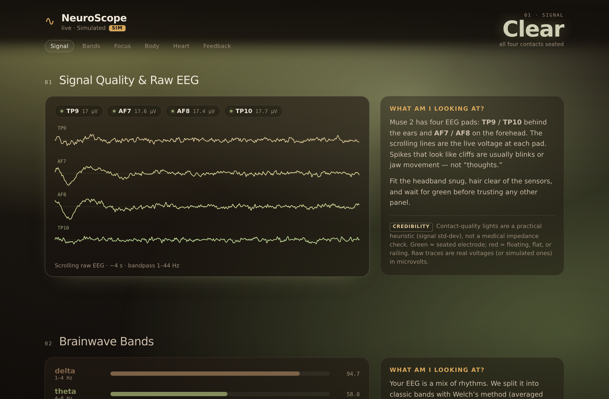
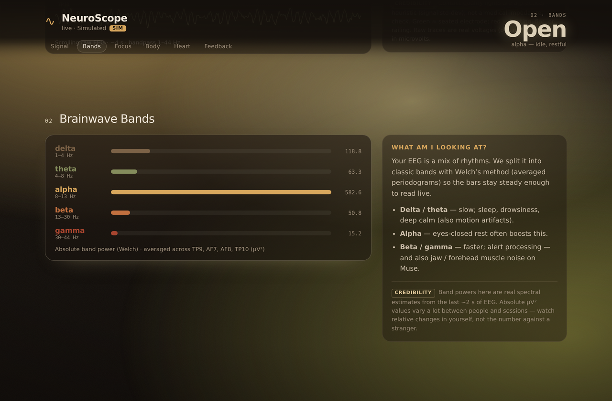
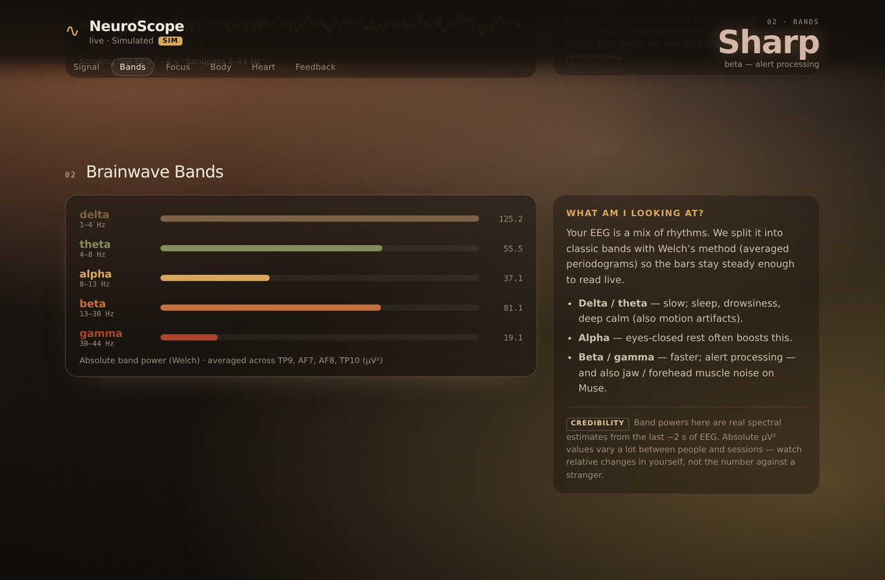
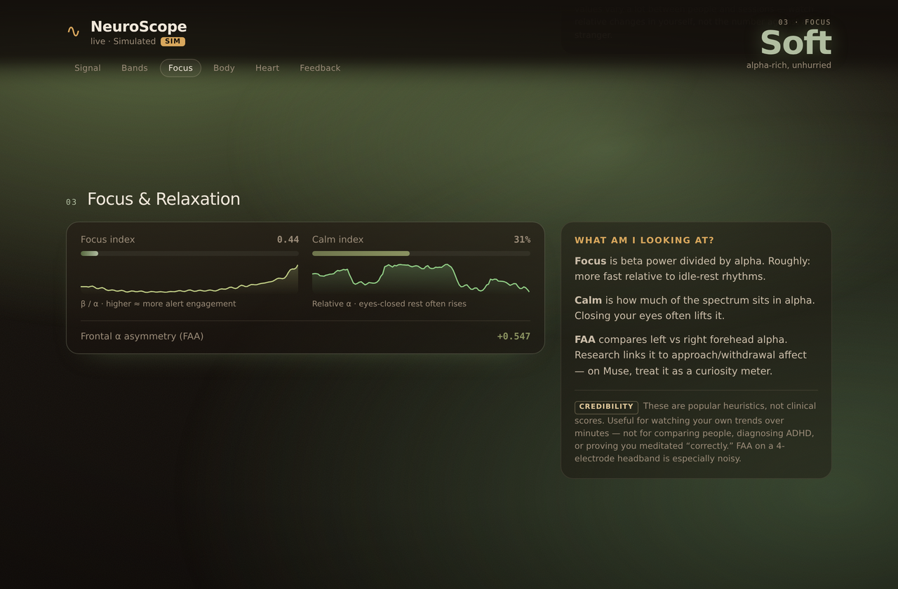
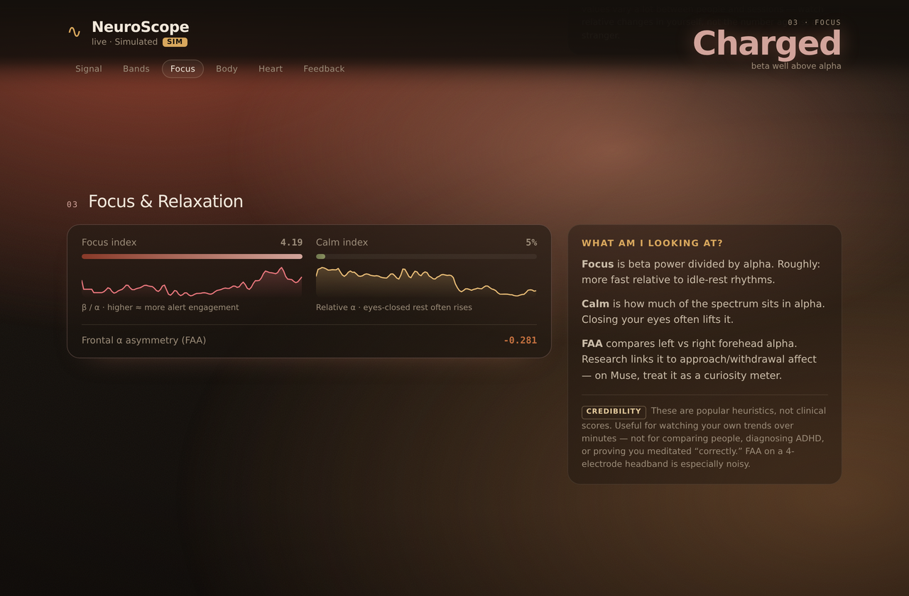
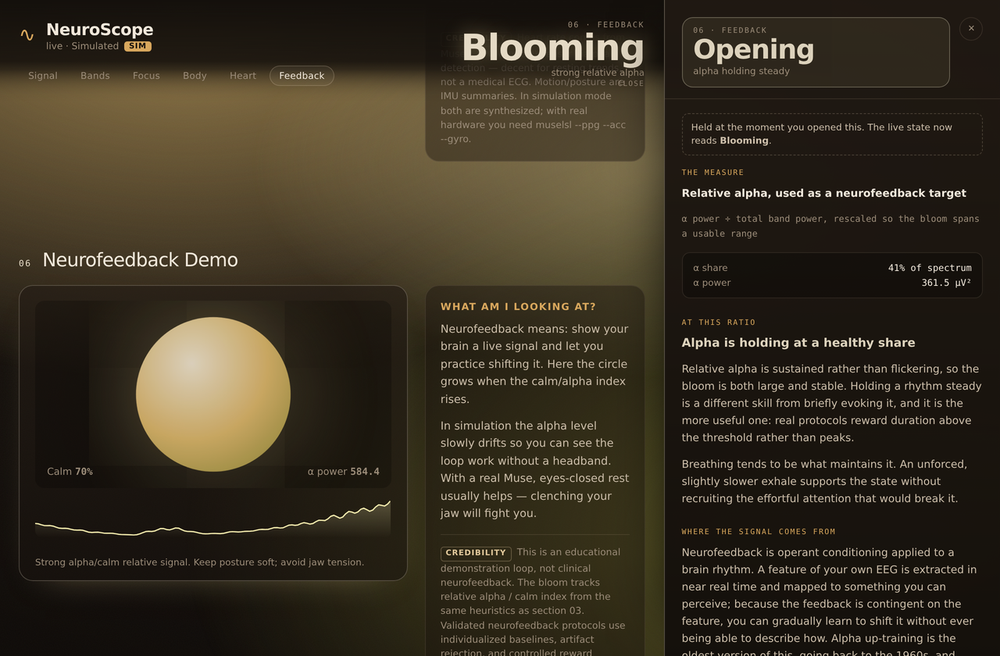

# NeuroScope

**Real-time consumer EEG signal-processing and visualization pipeline for the Interaxon Muse 2 headband** — continuous bandpass filtering, Welch power spectral density (PSD) estimation, physiological artifact detection, autonomic/kinematic context (PPG and IMU), and a closed-loop alpha neurofeedback demonstration, paired with a hardware-free stochastic simulator.

```text
Muse 2 ──BLE──► muselsl ──LSL──► Python (NumPy / SciPy) ──WebSocket──► React / Canvas
                 └─ or SimulatedSource (1/f + oscillations + EOG/EMG/PPG/IMU)
```

---

## 1. Scope and Scientific Framing

NeuroScope is an open, reproducible **educational and exploratory biosignal pipeline** designed to make the assumptions, transformations, and failure modes of four-channel dry-electrode consumer EEG transparent in real time.

### What this project is
- An end-to-end reference architecture for real-time biosignal acquisition and visualization: Lab Streaming Layer (LSL) ingress → digital filtering, spectral estimation, and artifact gating → 10 Hz WebSocket telemetry → `requestAnimationFrame`-decoupled Canvas UI.
- A transparent instrument for demonstrating canonical EEG phenomena (spectral $1/f$ scaling, eyes-closed posterior/temporal $\alpha$ elevation, $\alpha$-blocking under cognitive load, corneo-retinal blink dipoles, and masseter/temporalis EMG contamination).
- Fully executable without physical hardware via a continuous, phase-coherent synthetic generator (`SimulatedSource`).

### What this project is not
- **Not a medical device, diagnostic tool, or clinical BCI.**
- **Not a substitute for research-grade high-density EEG** (64+ wet/gelled Ag/AgCl electrodes with occipital and midline coverage).
- **Not a cross-subject psychometric instrument.** All derived cognitive heuristics (focus ratio, calm share, frontal alpha asymmetry) are strictly **within-session relative trends** and are accompanied in the interface by per-metric credibility notes and an inspectable physiological dossier.

---

## 2. System Architecture

| Layer | Implementation | Role |
|---|---|---|
| **Hardware** | Interaxon Muse 2 | 4 dry EEG channels (`TP9`, `AF7`, `AF8`, `TP10` at 256 Hz; Fpz reference), forehead optical PPG (64 Hz), 6-axis IMU (52 Hz) |
| **Acquisition** | `muselsl` + `pylsl` (`LSLSource`) or `SimulatedSource` | Unified `DataSource` polling interface returning time-aligned `SampleBatch` chunks |
| **Signal Processing** | Python 3.12 · NumPy · SciPy (`backend/processing/`) | Causal/zero-phase Butterworth filtering, Welch PSD, trapezoidal band integration, EOG/EMG detectors, PPG peak/HRV, IMU kinematics |
| **Transport** | FastAPI + Uvicorn (`backend/server.py`) | Async 10 Hz acquisition/processing loop broadcasting JSON frames over `/ws`, plus `/api/health` |
| **Visualization** | React 19 · TypeScript · Vite (`frontend/`) | Scrolling 4-channel trace canvas, band meters, artifact monitors, PPG/IMU cards, alpha bloom, and per-state physiological dossier |

---

## 3. Signal-Processing Methodology

All constants, filter cutoffs, band boundaries, and thresholds are centralized in [`backend/config.py`](backend/config.py).

### 3.1 Filtering and Trace Streaming
- **Analysis window:** Zero-phase 4th-order Butterworth bandpass (`scipy.signal.sosfiltfilt`, $1\text{–}44\text{ Hz}$) over the trailing $2.0\text{ s}$ window ($N = 512$ samples at $f_s = 256\text{ Hz}$). The $1\text{ Hz}$ high-pass attenuates electrode-skin DC drift; the $44\text{ Hz}$ low-pass suppresses $50/60\text{ Hz}$ mains interference and high-frequency myogenic noise.
- **Display stream:** Stateful causal 4th-order Butterworth bandpass (`scipy.signal.sosfilt` with persistent `zi` filter state across batches) so consecutive 10 Hz chunks stitch continuously without block-edge reflection transients.

### 3.2 Spectral Estimation (Welch PSD)
Over each $2.0\text{ s}$ filtered window, power spectral density $\hat{S}_{xx}(f)$ ($\mu\text{V}^2/\text{Hz}$) is estimated per channel via Welch's method of averaged modified periodograms (`scipy.signal.welch`, Hann window, segment length $L = 256$ samples $= 1.0\text{ s}$, $50\%$ overlap $\rightarrow 3$ overlapping segments, constant detrending, frequency bin spacing $\Delta f = 1.0\text{ Hz}$).

Absolute band power $P_b$ ($\mu\text{V}^2$) is computed by trapezoidal integration over canonical clinical bounds:

$$P_b = \int_{f_{\text{lo}}}^{f_{\text{hi}}} \hat{S}_{xx}(f)\,df$$

with $\delta\ [1,4]$, $\theta\ [4,8]$, $\alpha\ [8,13]$, $\beta\ [13,30]$, and $\gamma\ [30,44]\text{ Hz}$. Trapezoidal integration across contiguous closed intervals assigns $0.5$ weight to shared boundary bins on each side, preserving Parseval energy conservation across the full $1\text{–}44\text{ Hz}$ passband.

### 3.3 Contact Quality Heuristic
Because `muselsl` exposes raw voltage rather than continuous hardware impedance, pad seating is screened via windowed per-channel standard deviation $\sigma_c$ ($\mu\text{V}$):
- **Red (disconnected / flatline):** $\sigma_c < 0.3\ \mu\text{V}$
- **Green (plausible cortical range):** $0.3 \le \sigma_c \le 45.0\ \mu\text{V}$
- **Amber (elevated variance / noise):** $45.0 < \sigma_c \le 90.0\ \mu\text{V}$
- **Red (railing / severe artifact):** $\sigma_c > 90.0\ \mu\text{V}$

### 3.4 Derived Cognitive-State Heuristics
Let $\bar{P}_b = \frac{1}{4}\sum_{c \in \{\text{TP9,AF7,AF8,TP10}\}} P_{b,c}$ denote the four-channel mean power in band $b$:

- **Focus ratio ($\beta / \alpha$):**
  $$R_{\beta/\alpha} = \frac{\bar{P}_\beta}{\bar{P}_\alpha}$$
  Tracks cortical desynchronization / $\alpha$-blocking relative to faster $\beta$ power.
- **Calm index (relative $\alpha$):**
  $$P_{\alpha,\text{rel}} = \frac{1}{4}\sum_{c} \frac{P_{\alpha,c}}{\sum_{b \in \{\delta,\theta,\alpha,\beta,\gamma\}} P_{b,c}}$$
  Normalizes $\alpha$ power against total $1\text{–}44\text{ Hz}$ power per channel to reduce sensitivity to global amplitude scaling.
- **Frontal Alpha Asymmetry (FAA):**
  $$\text{FAA} = \ln(P_{\alpha,\text{AF8}} + \epsilon) - \ln(P_{\alpha,\text{AF7}} + \epsilon)$$
  Follows the standard Davidson convention (since $\alpha$ power indexes functional inhibition, positive values indicate greater right-frontal $\alpha$ / relatively greater left-frontal cortical activation).

### 3.5 Ocular & Myogenic Artifact Detection
Artifact detectors operate on the **unfiltered** trailing $2.0\text{ s}$ window (avoiding double high-pass attenuation) and inspect only the newest $0.2\text{ s}$ slice ($51$ samples) with refractory gating ($0.5\text{ s}$ blink, $0.6\text{ s}$ jaw) to avoid repeated counting across overlapping frames:
- **Eye blinks (EOG):** Peak $|x_{\text{0.5–6 Hz}}|$ across frontal `AF7`/`AF8` $> 90\ \mu\text{V}$.
- **Jaw clenches (EMG):** Root-mean-square $\text{RMS}(x_{\text{20–44 Hz}})$ across temporal `TP9`/`TP10` $> 28\ \mu\text{V}$.

### 3.6 Autonomic (PPG) and Kinematic (IMU) Context
- **Heart rate & HRV:** Forehead PPG ($64\text{ Hz}$, $8\text{ s}$ rolling buffer) is zero-phase bandpassed to $0.5\text{–}4.0\text{ Hz}$ ($30\text{–}240\text{ bpm}$) to remove respiratory baseline wander before systolic peak detection (`scipy.signal.find_peaks` with distance and prominence gating). Valid inter-beat intervals $\text{IBI}_i \in [60/180,\ 60/40]\text{ s}$ yield mean heart rate and short-window vagal HRV via RMSSD over consecutive valid intervals:
  $$\text{RMSSD} = \sqrt{\frac{1}{M}\sum (\text{IBI}_{i+1} - \text{IBI}_i)^2} \times 1000\ [\text{ms}]$$
- **Head motion & posture:** Accelerometer ($52\text{ Hz}$, $3\text{ s}$ buffer) yields dynamic motion $\sigma(\|\mathbf{a}\|) \times 1000\ [\text{mG}]$ and head tilt $\arccos(\bar{a}_z / \|\bar{\mathbf{a}}\|)\ [^\circ]$. Motion $> 25\ \text{mG}$ or mean gyroscopic rotation $> 15^\circ/\text{s}$ flags the `moving` veto state.

---

## 4. Neurophysiological Caveats & Hardware Limitations

1. **No occipital coverage:** Muse 2 lacks `O1`/`O2`/`Oz` electrodes. Resting-state occipital $\alpha$ reaches `TP9`/`TP10` and `AF7`/`AF8` only via attenuated volume conduction, yielding smaller $\alpha$ peaks than a standard 10–20 research cap.
2. **Frontal ocular and EMG vulnerability:** `AF7`/`AF8` sit directly above the orbits and frontalis, while `TP9`/`TP10` sit near the temporalis and masseter. Broadband EMG ($20\text{–}200+\text{ Hz}$) overlaps $\beta$ and $\gamma$, meaning sub-threshold jaw or brow tension can inflate the Focus ratio.
3. **Shared Fpz reference & FAA noise:** Both `AF7` and `AF8` are referenced to a single forehead site near `Fpz`, substantially reducing left-right independence and making dry-contact FAA highly sensitive to asymmetric pad impedance.
4. **Aperiodic $1/f$ confounding:** Narrowband power integrates both periodic oscillations and the broadband aperiodic $1/f$ background (Donoghue et al., 2020); a change in spectral slope shifts $\beta/\alpha$ and relative $\alpha$ even without a true oscillatory change.
5. **Motion coupling:** Head movement simultaneously introduces low-frequency electrode-motion potentials into $\delta$ ($1\text{–}4\text{ Hz}$) and mechanical shear into the optical PPG signal.

---

## 5. Simulation Model (`SimulatedSource`)

When running without physical hardware (`--source sim`), [`backend/sources/simulated.py`](backend/sources/simulated.py) synthesizes continuous multi-stream telemetry against an absolute sample clock:
- **EEG ($256\text{ Hz}$, 4 ch):** Stateful 3-pole/3-zero Kellet $1/f$ pinking filter per channel summed with phase-continuous narrowband sinusoids in $\delta\text{–}\gamma$, modulated by a slow ($\sim 20\text{ s}$) $\alpha/\beta$ drift cycle (`SIM_ALPHA`, `SIM_BETA` env vars).
- **Artifacts:** Stochastic frontal EOG blink deflections ($220\text{–}320\ \mu\text{V}$, rendered continuously across chunk boundaries) and temporal-dominant EMG bursts ($20\text{–}44\text{ Hz}$ RMS $> 28\ \mu\text{V}$).
- **PPG ($64\text{ Hz}$) & IMU ($52\text{ Hz}$):** Beat-to-beat variable pulse trains ($\sim 68\text{ bpm}$, resting RMSSD $\sim 35\text{ ms}$) superimposed on $0.25\text{ Hz}$ respiratory baseline wander, plus gravity-referenced $3$-axis acceleration with occasional posture shifts.

| Feature | Simulation (`sim`) | Muse 2 (`lsl`) |
|---|---|---|
| Raw EEG & contact quality | Synthetic ($1/f$ + oscillations) | Live (`TP9`, `AF7`, `AF8`, `TP10`) |
| Welch band powers / Focus / Calm / FAA | Computed by full pipeline | Computed by full pipeline |
| Blink & jaw EMG detection | Injected EOG & EMG events | Live frontal EOG & temporal EMG |
| Heart rate / RMSSD | Synthetic PPG with HRV | Live PPG (requires `muselsl --ppg`) |
| Motion & posture tilt | Synthetic IMU + posture shifts | Live IMU (requires `--acc --gyro`) |

---

## 6. Quick Start

Requires **Python 3.12** (not 3.14; `numpy>=2.5` requires $\ge 3.12$) and **Node.js 18+**.

### Simulation Mode (No Hardware Required)

```bash
# 1. Backend
python3.12 -m venv .venv
source .venv/bin/activate
pip install -r requirements.txt
./run_backend.sh                  # or: .venv/bin/python -m backend.server --source sim

# 2. Frontend (second terminal)
cd frontend && npm install && npm run dev
```

Open **http://127.0.0.1:5173** — the header shows **Simulated** with a **SIM** badge.  
Health check: `curl http://127.0.0.1:8000/api/health`

### Real Muse 2 Acquisition (macOS / Apple Silicon)

1. Put the Muse 2 in pairing mode with Bluetooth enabled.
2. Install native LSL:
   ```bash
   brew install labstreaminglayer/tap/lsl
   export DYLD_LIBRARY_PATH=/opt/homebrew/lib
   ```
3. Stream from `muselsl` in a dedicated terminal:
   ```bash
   muselsl list
   muselsl stream --ppg --acc --gyro
   ```
4. Launch the backend in LSL mode:
   ```bash
   ./run_backend.sh lsl
   # or: NEUROSCOPE_SOURCE=lsl .venv/bin/python -m backend.server
   ```
5. Start the frontend (`./run_frontend.sh`) — status updates to **Muse 2 (LSL)**.

*Notes:* Only one BLE client may connect to the Muse 2 at a time; close mobile/desktop Muse apps first. Without `--ppg --acc --gyro`, the heart and motion panels degrade gracefully to empty states.

---

## 7. Visual Instrument & Interpretive State System

The interface avoids clinical styling in favor of an earth-tone visual system whose background gradient and top-right **state word** track the active section (via `IntersectionObserver`) and live signal values inside a single `requestAnimationFrame` CSS-variable loop:

| Section | Quantity Evaluated | State Vocabulary |
|---|---|---|
| `01 · Signal` | Pad voltage $\sigma_c$ ($\mu\text{V}$) across 4 channels | `Drifting` · `Settling` · `Seated` · `Clear` |
| `02 · Bands` | Band share normalized against resting $1/f$ baseline | `Deep` · `Drift` · `Open` · `Sharp` · `Bright` |
| `03 · Focus` | $R_{\beta/\alpha}$ engagement vs $P_{\alpha,\text{rel}}$ rest | `Adrift` · `Soft` · `Even` · `Engaged` · `Charged` |
| `04 · Body` | Frontal EOG blinks & temporal EMG bursts | `Still` · `Blink` · `Clench` · `Restless` |
| `05 · Heart` | PPG heart rate gated by IMU stillness | `Listening` · `Settled` · `Steady` · `Stirring` · `Racing` |
| `06 · Feedback` | Rescaled $P_{\alpha,\text{rel}}$ driving the bloom | `Quiet` · `Easing` · `Opening` · `Blooming` |

Clicking the state word opens a frozen snapshot panel detailing the exact formula, captured numerical values, underlying neurophysiology, and explicit interpretive limits.

### Interface Preview & State Transitions (Simulation Mode)

#### `01 · Signal` — Contact Quality & 4-Channel Raw EEG


#### `02 · Bands` — Spectral Profile Shift (Alpha-Dominant `Open` vs. Beta-Dominant `Sharp`)
| Alpha-dominant (`SIM_ALPHA=3.4 SIM_BETA=0.25`) | Beta-dominant (`SIM_ALPHA=0.35 SIM_BETA=2.8`) |
|---|---|
|  |  |

#### `03 · Focus` — $\beta/\alpha$ & Relative-$\alpha$ Ratio Shift (`Soft` vs. `Charged`)
| Restful alpha-rich (`Soft`, $\beta/\alpha = 0.44$) | Alert beta-rich (`Charged`, $\beta/\alpha = 4.19$) |
|---|---|
|  |  |

#### `06 · Feedback` — Alpha-Driven Bloom & Inspectable Physiological Dossier


---

## 8. Configuration & Verification

### Configuration Knobs
- **Signal parameters & thresholds:** [`backend/config.py`](backend/config.py)
- **Data source selection:** `--source sim|lsl` or `NEUROSCOPE_SOURCE=sim|lsl`
- **Simulated state modulation:** `SIM_ALPHA` and `SIM_BETA` environment variables

### Running Tests & Static Checks

```bash
# Backend unit & integration tests (filters, Parseval Welch check, artifacts, PPG, IMU, pipeline)
.venv/bin/python -m unittest discover -s tests -v

# Frontend lint, TypeScript check, and production build
cd frontend && npm run lint && npm run build
```

---

## 9. Project Structure

```text
neuroscope/
├── backend/
│   ├── server.py               # FastAPI + async 10 Hz WebSocket hub
│   ├── config.py               # Hardware constants, band edges, thresholds
│   ├── sources/                # DataSource interface, SimulatedSource, LSLSource
│   └── processing/             # filters, bandpower, indices, artifacts, heart, motion, pipeline
├── docs/screenshots/           # Captured UI previews across wave-ratio states
├── frontend/                   # React 19 + TypeScript + Vite dashboard & Terra state system
├── tests/                      # Python unit & end-to-end simulation pipeline tests
├── CITATION.cff
├── requirements.txt
├── run_backend.sh
└── run_frontend.sh
```

Official Interaxon LibMuse / MuseLab SDKs are **not** bundled or required; live acquisition uses the open `muselsl` + `pylsl` stack.

---

## 10. References

- Allen, J. J. B., Coan, J. A., & Nazarian, M. (2004). Issues and assumptions on the road from raw signals to metrics of frontal EEG asymmetry in emotion. *Biological Psychology*, 67(1–2), 183–218.
- Davidson, R. J. (2004). What does the prefrontal cortex "do" in affect: perspectives on frontal EEG asymmetry research. *Biological Psychology*, 67(1–2), 219–234.
- Donoghue, T., et al. (2020). Parameterizing neural power spectra into periodic and aperiodic components. *Nature Neuroscience*, 23(12), 1655–1665.
- Jensen, O., & Mazaheri, A. (2010). Shaping functional architecture by oscillatory alpha activity: gating by inhibition. *Frontiers in Human Neuroscience*, 4, 186.
- Klimesch, W. (1999). EEG alpha and theta oscillations reflect cognitive and memory performance: a review and analysis. *Brain Research Reviews*, 29(2–3), 169–195.
- Kothe, C., et al. Lab Streaming Layer (LSL). https://labstreaminglayer.org
- Krigolson, O. E., Williams, C. C., Norton, A., Hassall, C. D., & Colino, F. L. (2017). Choosing MUSE: Validation of a low-cost, portable EEG system for ERP research. *Frontiers in Neuroscience*, 11, 109.
- Shaffer, F., & Ginsberg, J. P. (2017). An overview of heart rate variability metrics and norms. *Frontiers in Public Health*, 5, 258.
- Welch, P. D. (1967). The use of fast Fourier transform for the estimation of power spectra: A method based on time averaging over short, modified periodograms. *IEEE Transactions on Audio and Electroacoustics*, 15(2), 70–73.

---

## Citing

If you use NeuroScope in research, teaching, or derived work, please cite [`CITATION.cff`](./CITATION.cff):

```bibtex
@software{Ozkan_NeuroScope_2026,
  author  = {Ozkan, Enes},
  title   = {{NeuroScope}: Real-time Muse 2 EEG Dashboard},
  year    = {2026},
  version = {0.2.0},
  url     = {https://github.com/dopalici/neuroscope}
}
```

## Disclaimer

Educational and exploratory signal-processing tooling only. **Not a medical device.** Derived heuristics reflect within-session trends and must not be used for clinical screening, diagnosis, or inter-subject comparison.
